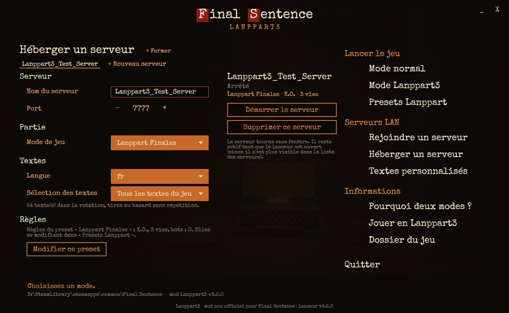
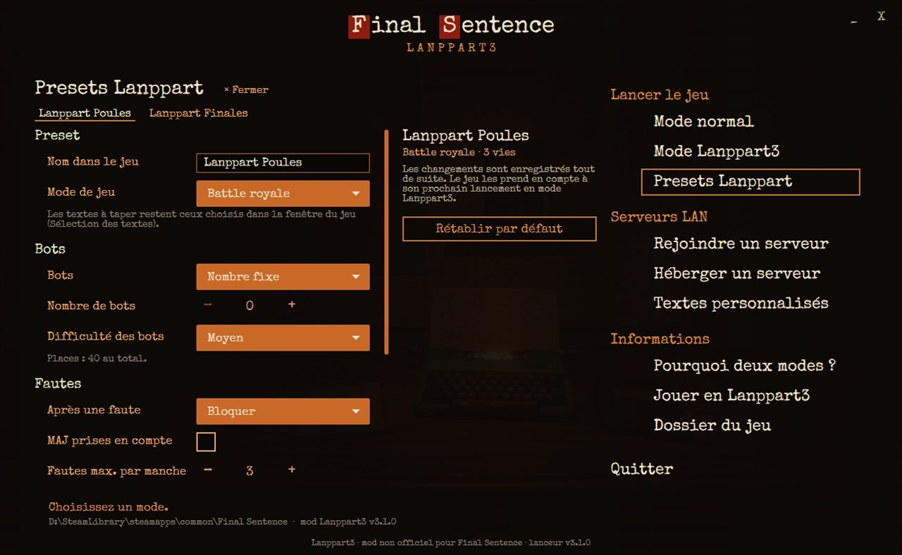
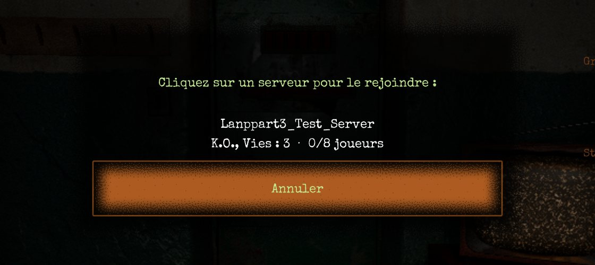
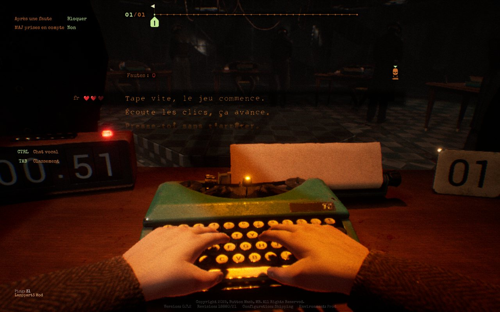
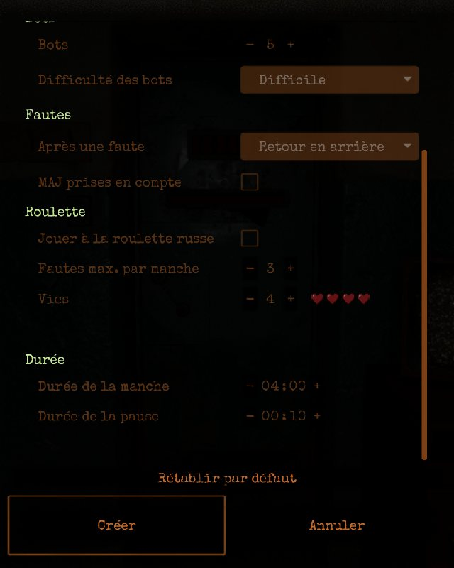
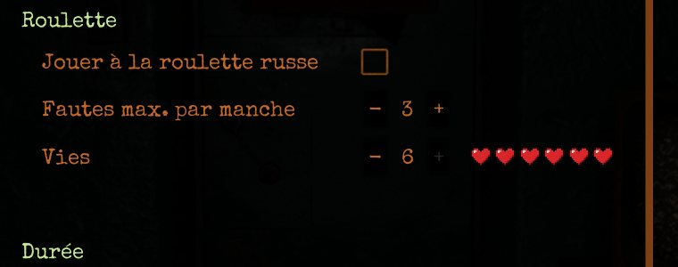
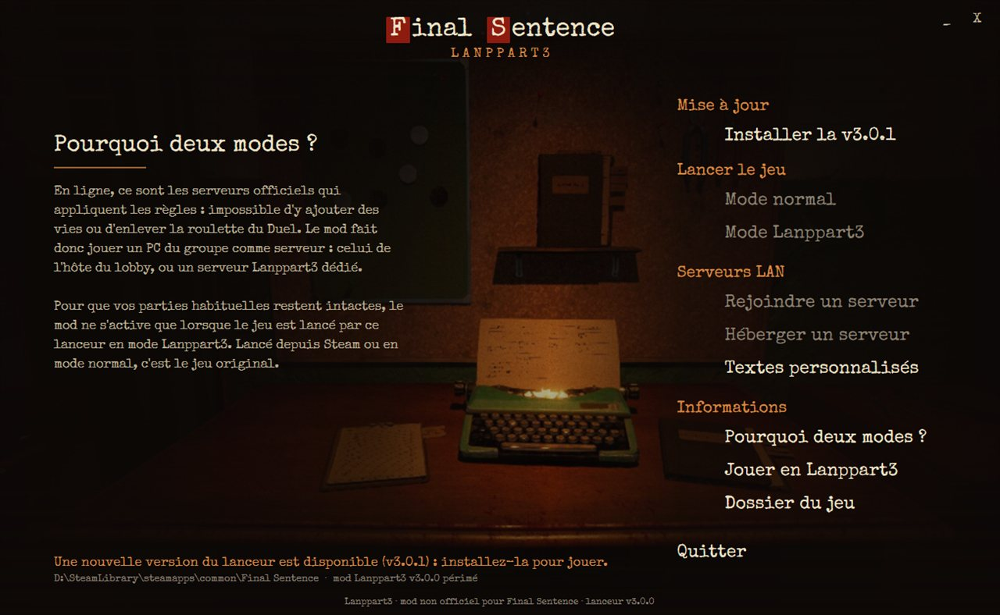

# Final Sentence Enhanced (Lanppart3)

Mod non officiel pour [Final Sentence](https://store.steampowered.com/app/2413950/) : parties entre amis
aux règles libres, en LAN ou via Radmin VPN.

- **Serveurs dédiés** pilotés depuis le lanceur (sans fenêtre, plusieurs à la fois), ou lobby hébergé
  par l'hôte.
- **Roulette russe ou vies** dans tous les modes (Battle royale, K.O., Duel), affichées en cœurs.
- **Presets de lobby** (Lanppart Poules, Lanppart Finales) entièrement réglables dans le lanceur.
- **Textes personnalisés** gardés sur le serveur : les joueurs les découvrent en jouant.
- **Liste des serveurs** du réseau local dans le lanceur et dans le jeu.

## Aperçu

| Lanceur : héberger un serveur | Lanceur : presets Lanppart |
| --- | --- |
|  |  |

| Dans le jeu : serveurs LAN | En attente de l'organisateur |
| --- | --- |
|  |  |

| K.O. avec vies (Lanppart Finales) | Création de partie avec un preset |
| --- | --- |
|  |  |

Les vies en cœurs, dans le classement (Tab) et sur la ligne « Vies » :




Un lanceur périmé ne lance pas le jeu : il propose d'abord la mise à jour.



## Installation

Télécharger `Lanppart3-Final-Sentence.exe` dans les
[Releases](https://github.com/xams0/final-sentence-enhanced/releases/latest) et le lancer. C'est tout :
le lanceur contient le mod et le charge dans le jeu qu'il démarre. Le dossier du jeu n'est jamais
modifié, et le jeu lancé depuis Steam reste l'original.

Le lanceur se met à jour depuis ce dépôt. Tant qu'une nouvelle version n'est pas installée, il ne lance
pas le jeu : tous les joueurs ont ainsi la même version.

Mode d'emploi complet : [mod/LISEZMOI.txt](mod/LISEZMOI.txt).

## Contenu du dépôt

| Dossier | Contenu |
| --- | --- |
| `launcher/` | Lanceur WPF (.NET Framework 4.8) : modes, serveurs dédiés, liste des serveurs, textes, injection, mises à jour |
| `mod/Lanppart/` | Mod Lua pour [UE4SS](https://github.com/UE4SS-RE/RE-UE4SS) (scripts et images) |
| `native/` | DLL native du mod (serveur d'écoute, Iris, vies, serveurs dédiés) |
| `mod/package.sh` | Construit `dist/Lanppart3-Final-Sentence.exe` |
| `mod/deploy.sh`, `mod/dev/` | Outils de développement |
| `tools/` | Images des cœurs, captures (JPEG), publication d'une version |
| `docs/images/` | Captures d'écran du README |

## Construire

Prérequis : Git Bash, [zig](https://ziglang.org/) 0.17 (DLL native), SDK .NET (lanceur net48),
UE4SS v3.0.1 experimental décompressé (dossier contenant `ue4ss/UE4SS.dll`).

```sh
UE4SS_DIR=/chemin/vers/ue4ss ZIG=/chemin/vers/zig.exe mod/package.sh
```

## Publier une version

1. Monter `<Version>` dans `launcher/Lanppart3Launcher.csproj` (ex. `3.1.0`).
2. `mod/package.sh`, puis `tools/release.sh` : crée la release `v3.1.0` sur GitHub avec le lanceur.

Les lanceurs déjà installés la détectent et proposent de l'installer.

---

Mod non officiel, sans lien avec les développeurs du jeu. Les parties Lanppart3 ne comptent pas pour les
statistiques et classements officiels. Testé avec Final Sentence 0.7.2 (révision 18880).
